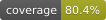

# BookLibre - Grupo 6

# Programación con Herramientas Modernas
# Trabajo práctico 2026
- - -
## Dominio general
“Que la fuerza te acompañe… y que te devuelvan el libro en fecha.”

Bienvenidos a BookLibre: una app para pedir, prestar y reclamar sin caer en el
Lado Oscuro.

#### Usuarios
En primer lugar tenemos a los usuarios. De los mismos se sabe que tienen:
- Nombre completo (nombre y apellido)
- Una breve descripción de un renglón (por ejemplo “Lector intrépido”)
- Su email
- Su nro de celular
- La ciudad donde reside
- El tipo de usuario (o rol dentro de la aplicación que puede ser: lector,
publicador o lector / publicador). Por el momento no tiene
comportamiento asociado.

#### Libros
Obviamente vamos a tener libros para prestar o que nos presten. De ellos
conocemos:
- Título
- Tipo (puede ser común, con dedicatoria y coleccionable)
- Descripción
- Género (Drama, Ciencia ficción, Romance, Autoayuda, diseño y literatura
clásica)
- Autor
- Cantidad de páginas
- ISBN-13 (código unívoco para identificar libros)
- Idioma (Español, Inglés, Francés y Portugués)
- Editorial
- Fecha de publicación
- Estado del libro (Se refiere a las condiciones que se encuentra el libro que
pueden ser Excelente, Muy bueno, Bueno, malo y regular).

Los tipos de libros determinan cuántos **BiblioKarmas** le suman al lector. Los
bibliokarmas son la unidad de scoring que pondera el nivel de lectura de un
usuario. En todos los casos suma 5 bibliokarmas por cada día de reserva + un
plus que depende del tipo.
- Para los libros comunes se calcula como la cantidad de páginas del libro
multiplicado por 5 si es que el usuario tiene menos de 1000 bibliokarmas,
o multiplicado por 2 de lo contrario.
- Para los libros con dedicatoria se calcula como 200 + 10 * cantidad de
reservas que tiene el libro
- Para los libros coleccionables se calcula como la quinta parte de los
bibliokarmas que tiene el usuario (no se trabaja con decimales, se
redondea hacia el valor superior entero inmediato) + la cantidad de
páginas del libro.

Los tipos de libro no cambian con el tiempo.

También vamos a poder reservar libros. En todos los casos tienen un rango de
fechas en las cuales voy a usar el libro (desde y hasta). Solamente fecha y no
hora. Al momento de reservar el libro se incrementan automáticamente los
bibliokarmas al usuario lector.

## Entregables
#### Interfaz de usuario + Backend

Se pide que construya la interfaz de usuario (solo versión desktop) de los
siguientes casos de uso:
1. Login y registro
2. Para un usuario consultar libros disponibles de reserva en un rango de
   fechas y filtrando por varios parámetros de búsqueda.
3. Para un usuario ver el detalle de un libro.
4. Para un usuario ver su perfil y su lista de libros ofrecidos.
5. Para un usuario editar uno de un libros.
6. Para un usuario consultar su lista de reservas realizadas y recibidas.

La implementación podrá hacerla en la tecnología que quieran. La misma no es necesario que sea responsive. El backend debe encontrarse modelado en kotlin + Spring Boot.
